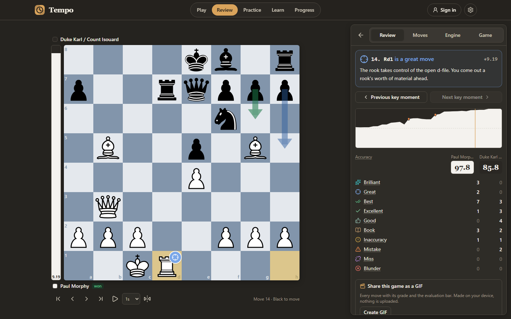
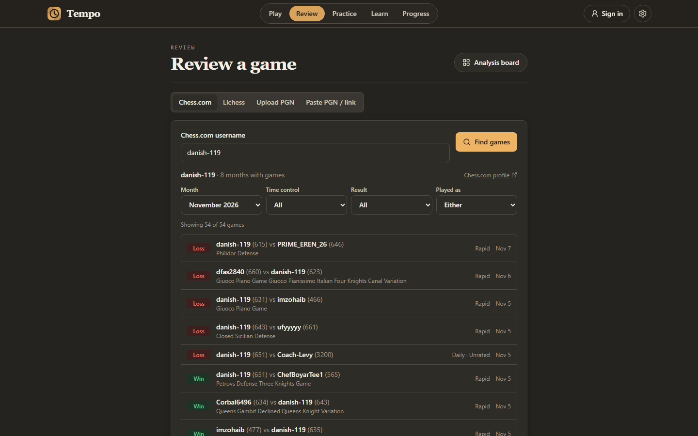
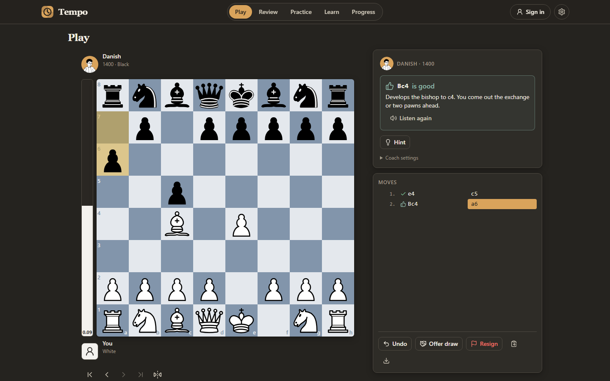
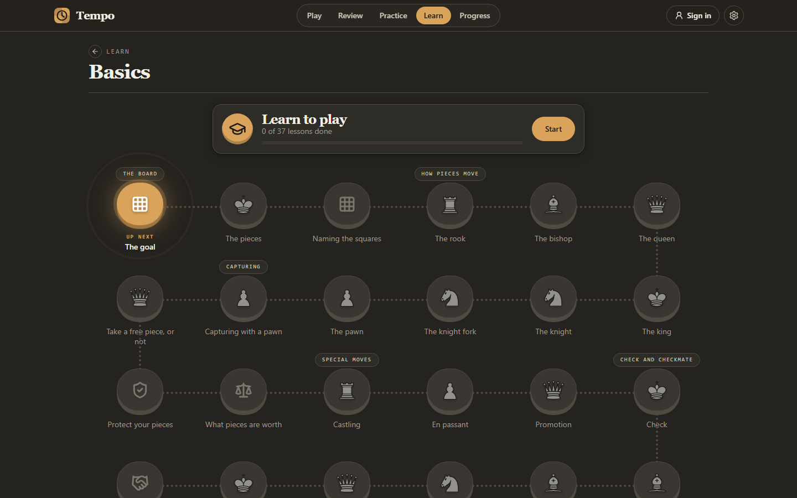
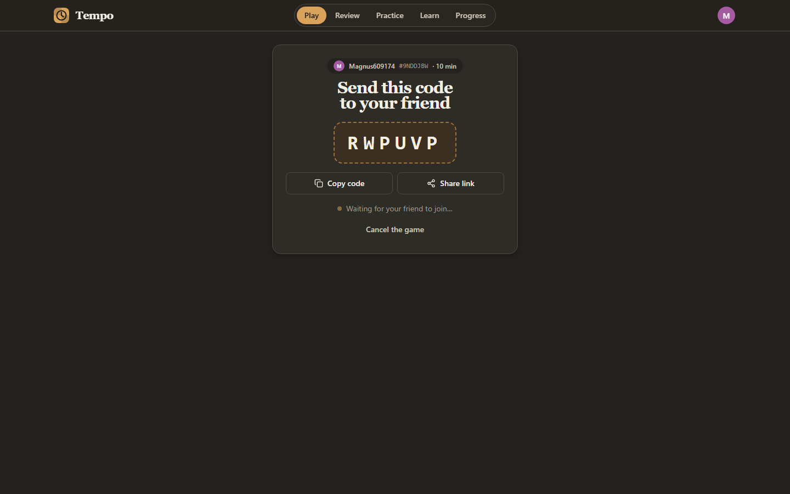
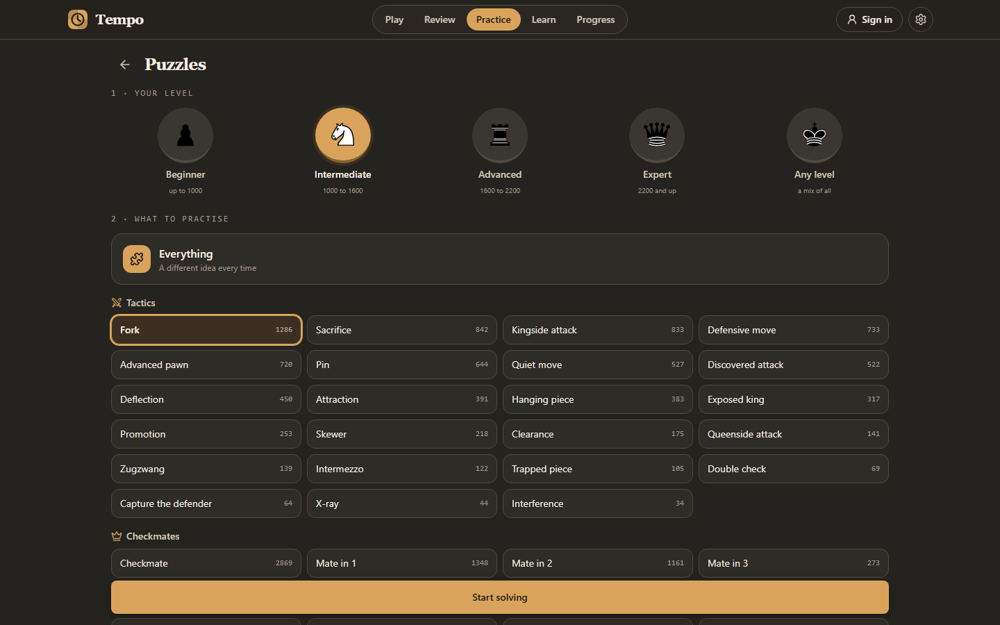
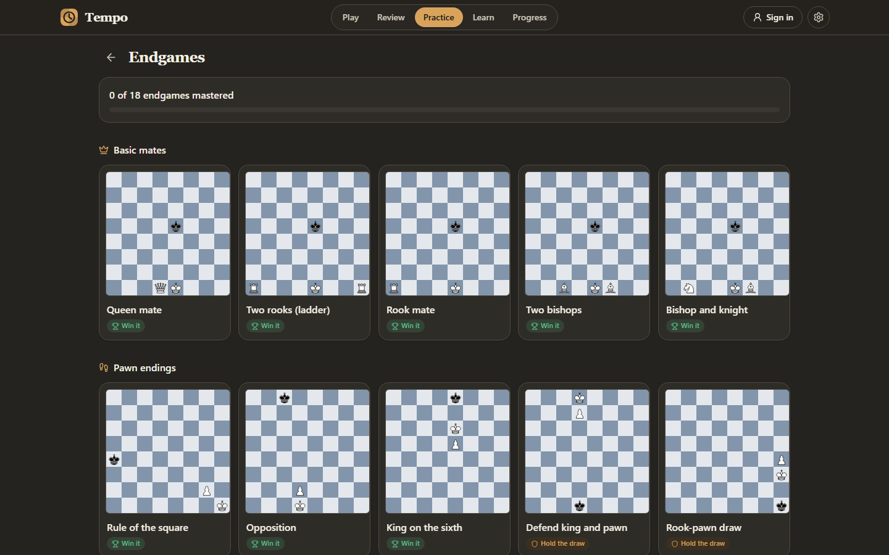

# Tempo — play, review and practise chess, free

**Live:** https://tempochess.vercel.app

Tempo lets you play bots, a coach or a friend, review your games move by move, practise with puzzles and endgames, and learn chess from the first move to openings and tactics. Stockfish 19 runs **inside your browser** (WebAssembly), so analysis is free, fast and works offline. A free account keeps your games, progress and settings on every device.



| | |
| --- | --- |
|  |  |
| **Review**: import from Chess.com, Lichess or PGN | **Play**: bots, a coach, a friend or anyone online |
|  |  |
| **Learn**: a 37-lesson course from the very first move | **Online**: share a short code and play |
|  |  |
| **Puzzles**: 10,000, by level and theme | **Endgames**: against perfect tablebase defence |

- Import public **Chess.com** or **Lichess** games by username, paste a Lichess game link, upload `.pgn` files, or paste PGN.
- **Full game review**: every move classified (Brilliant, Great, Best, Excellent, Good, Book, Inaccuracy, Mistake, Miss, Blunder), per-player accuracy, key moments, an evaluation graph and move-quality badges on the board.
- **Deterministic explanations** (no AI): forks, pins, hanging pieces and mates are named only when the engine line proves them.
- **Live analysis**: eval bar, multiple engine lines, depth/nodes, explore any line as a variation without changing the game.
- **Play**: **Play with Bot** (10 bots, ≈400 to full Stockfish), **Play with Coach** (hints, threat arrows, eval bar, move feedback, chosen rating) and **Play in Person** on one device (flip / two boards / fixed view, draw and resign). Optional clock, history view, Undo, Abort, resume an unfinished game.
- **Practice**: 10,000 Lichess puzzles (CC0) served at random, filtered by level and theme, with hints and solutions; **Puzzle Rush** (3 min / 5 min / Survival).
- **Endgames**: 18 key endgames against perfect tablebase defence, with Watch | Practice. **Coordinates** trainer (find, name or colour the square; timed or untimed).
- **Learn**: a 37-lesson **Basics** course for complete beginners (from how each piece moves to checkmate, stalemate, draws and good opening habits, with a talking coach and 2 to 3 practices per lesson), 22 openings explained move by move as they are played, 27 tactics and mating patterns you practise on real positions with hints, and a 116-term glossary with diagrams.
- **Board editor** (Play → Set up a position): set up any position, then analyze it or play it out against a bot.
- **Share**: game links packed into the URL fragment (no upload), links to any puzzle, endgame, opening or tactic, and PNG board images.
- **Endgame tablebase** (≤ 7 pieces) in analysis. Retry any mistake from a review.
- **Exports**: original PGN, annotated PGN (`[%eval]`, NAGs, comments, best-line variations), FEN, printable report.
- **Play online**: create a game and send your friend its 6-character code or link; they type the code to join. No account needed: a guest picks a nickname and a picture and plays. The server checks every move and runs the clocks; draw offers and resign included, and anyone with the code can watch live. See [how it works](docs/ARCHITECTURE.md#online-games).
- **Installable and offline**: Tempo is a PWA. Install it on your phone or desktop and it works with no connection, including the engine and puzzles.
- **Accounts and guests**: every player has a **Tempo ID** (such as `#4K7F2QD`) that tells players with the same name apart, and a display name they can change. Games, reviews, progress, lesson progress and settings are saved on the server. No account needed: the first time a visitor saves something, Tempo asks whether to keep it as a guest (a nickname and a picture, with a Tempo ID) or with Google. A guest's and their progress is kept on the server while they come back at least once every 30 days on that browser. Signing in with Google keeps it for good, on every device (a new account keeps the guest's ID).
- **Progress**: streak, puzzle-rating estimate, a daily puzzle and an activity calendar.
- **Training modes**: **Blindfold** (play a bot with the board hidden, typing moves).
- **Share as a GIF**: export a reviewed game as an animated GIF with the board, evaluation bar and move grades, encoded in the browser.
- **Spoken coach** (browser speech synthesis, no AI): it reads out exactly what is written, in Play with Coach, Endgames, Basics, Tactics and Openings.
- **Accessibility**: spoken move announcements for screen readers, a colour-blind-safe move palette, a keyboard shortcut overlay (`?`).
- **Appearance**: 8 board themes, 10 piece sets, light/dark mode, sounds (Lichess SFX); settings open in a modal.
- Keyboard navigation, a one-screen desktop layout, and a phone layout with a bottom tab bar where every main page fits the screen.


## Quick start

Requirements: **Node.js ≥ 20.9** (tested on Node 24) and npm.

```bash
npm install          # installs deps (stockfish engine comes from npm)
npm run dev          # http://localhost:3000  (copies engine assets first)
```

For accounts and saved data, also run the API (in a second terminal):

```bash
cd server
npm install
cp .dev.vars.example .dev.vars   # then set BETTER_AUTH_SECRET in it
npm run db:migrate:local   # creates the local database
npm run dev                # http://localhost:8787
```

Without the API the app still works; nothing is saved.

## Scripts

| Command | What it does |
| --- | --- |
| `npm run dev` | Dev server (with cross-origin isolation headers, so multi-threaded Stockfish works) |
| `npm run build` | Static production build into `out/` (copies engine, regenerates header configs) |
| `npm start` | Serves `out/` on http://localhost:4173 with production headers |
| `npm run typecheck` | `tsc --noEmit` (strict) |
| `npm run lint` | ESLint |
| `npm test` | Vitest unit + integration tests (integration uses the **real** Stockfish build) |
| `npm run test:e2e` | Playwright end-to-end tests against the production build (`npm run build` first; `npx playwright install chromium` once) |
| `npm run check` | typecheck + lint + tests + build |
| `node scripts/build-puzzles.mjs` | Re-sample the practice puzzles from the Lichess database (needs network; resumes; unique by id and position) |
| `npm run headers` | Regenerate `vercel.json` and `public/_headers` from `scripts/headers.mjs` |
| `cd server && npm run dev` | The API on http://localhost:8787 with a local database |
| `cd server && npm run db:generate` | Create a migration after changing `server/src/db/schema.ts` |
| `cd server && node scripts/smoke.mjs` | End-to-end check of accounts, guests and saved data against the running API |
| `cd server && node scripts/online-smoke.mjs` | End-to-end check of an online game (create, join by code, play, watch) against the running API |

## Environment variables

All optional for the app; see `.env.example`. The API's settings are in [Deployment](docs/DEPLOYMENT.md).

| Variable | Purpose |
| --- | --- |
| `NEXT_PUBLIC_SITE_URL` | Canonical URL for metadata, sitemap and robots. Defaults to https://tempochess.vercel.app |
| `NEXT_PUBLIC_REPO_URL` | Public source repository — shown in the footer/About page (needed for GPL source availability). Defaults to https://github.com/danish-119/tempo-chess |
| `NEXT_PUBLIC_WHATSAPP` | WhatsApp number (digits, international format) for a wa.me contact link on the About page. Defaults to 923001877119 |
| `NEXT_PUBLIC_API_URL` | The Tempo API. Defaults to http://localhost:8787 |
| `NEXT_PUBLIC_CONTACT_EMAIL` | Support/contact address shown in the footer and on the About and Privacy pages. Defaults to mdanish.software.dev@gmail.com |

## The engine

- Package: [`stockfish`](https://www.npmjs.com/package/stockfish) **19.0.1** (Stockfish.js by Nathan Rugg / Chess.com, based on official Stockfish 19), **GPL-3.0**.
- Builds used: `stockfish-19-lite.js/.wasm` (multi-threaded, needs cross-origin isolation) and `stockfish-19-lite-single.js/.wasm` (fallback). The NNUE network is embedded in the `.wasm`.
- `scripts/copy-engine.mjs` copies them to `public/engine/` (along with `COPYING.txt` and `engine.json`) on `dev`, `build` and `test`.
- Threads default to *Auto* (all logical cores but one, max 8; max 2 on mobile). Hash scales with device memory.

## Docs

- [Architecture](docs/ARCHITECTURE.md)
- [Deployment](docs/DEPLOYMENT.md)
- [Features & limitations](docs/FEATURES.md)
- [Troubleshooting](docs/TROUBLESHOOTING.md)
- [Security policy](SECURITY.md) · [Contributing](CONTRIBUTING.md) · [Third-party licenses](THIRD_PARTY_LICENSES.md)

## License

Tempo, including the API in `server/`, is licensed under the **GNU GPL v3.0 or later** (see [LICENSE](LICENSE)), because it distributes the GPL-3.0 Stockfish engine. If you deploy it publicly you must offer the corresponding source code — publishing this repository and setting `NEXT_PUBLIC_REPO_URL` satisfies that. Third-party notices are in [THIRD_PARTY_LICENSES.md](THIRD_PARTY_LICENSES.md).
