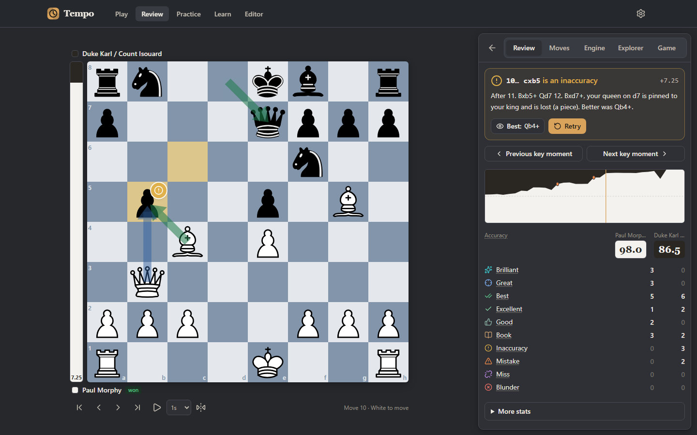
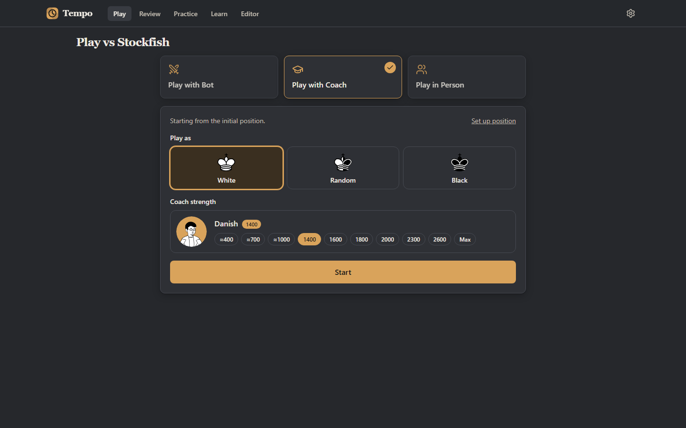
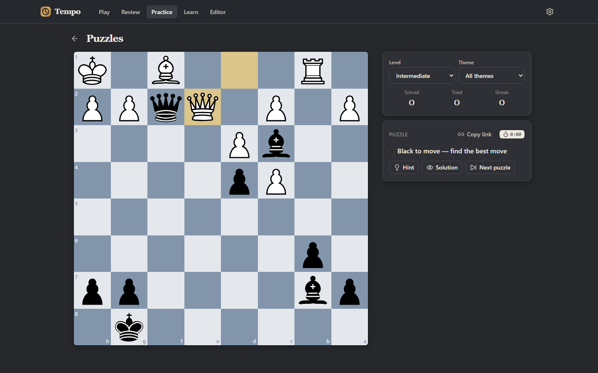
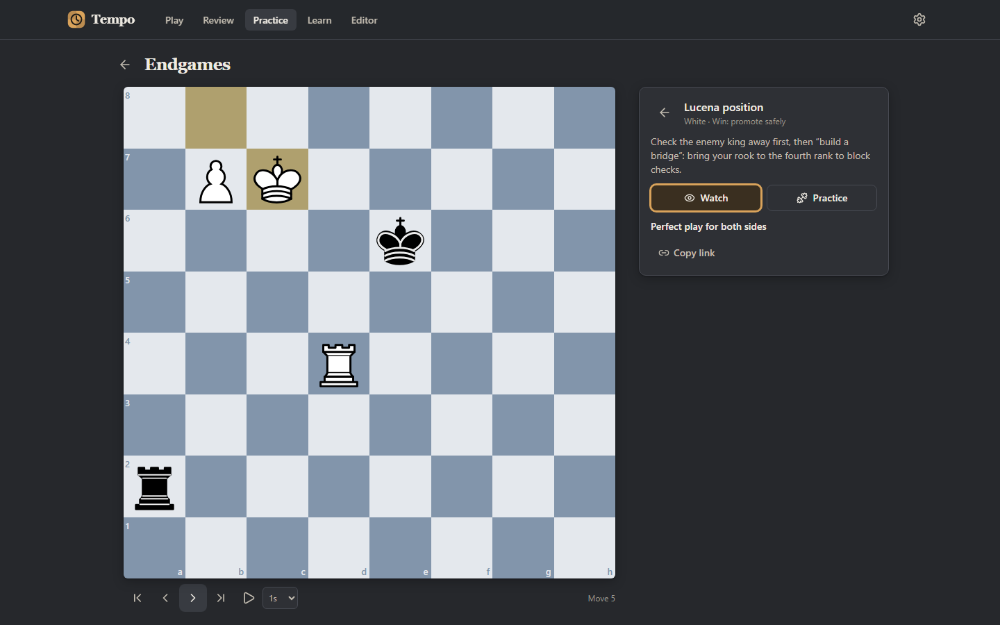
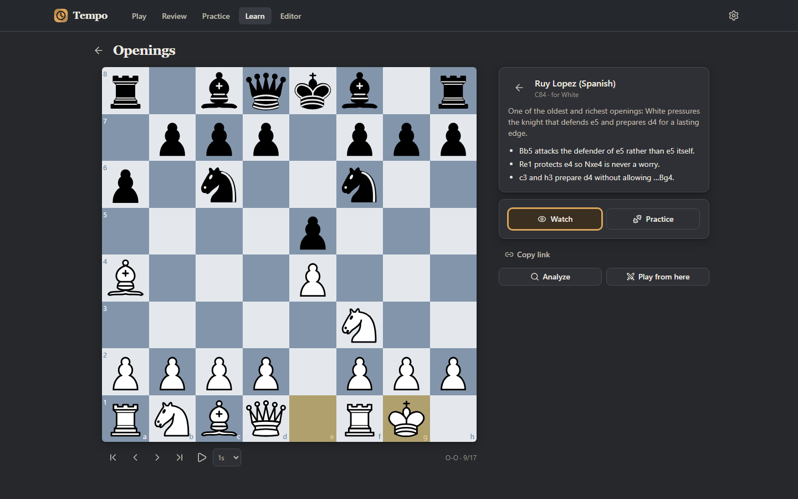

# Tempo — play, review and practise chess, free

**Live:** https://tempochess.vercel.app

Tempo lets you play bots, a coach or a friend, review your games move by move, practise with puzzles and endgames, and learn openings and tactics. Stockfish 19 runs **inside your browser** (WebAssembly), so there is no backend, no database, no account and no upload of your games.



| | |
| --- | --- |
|  |  |
| **Play** — bots, a coach or a friend | **Puzzles** — 10,000, by level and theme |
|  |  |
| **Endgames** — against perfect tablebase defence | **Learn** — openings, tactics and a glossary |

- Import public **Chess.com** or **Lichess** games by username, paste a Lichess game link, upload `.pgn` files, or paste PGN.
- **Full game review**: every move classified (Brilliant, Great, Best, Excellent, Good, Book, Inaccuracy, Mistake, Miss, Blunder), per-player accuracy, key moments, an evaluation graph and move-quality badges on the board.
- **Deterministic explanations** (no AI): forks, pins, hanging pieces and mates are named only when the engine line proves them.
- **Live analysis**: eval bar, multiple engine lines, depth/nodes, explore any line as a variation without changing the game.
- **Play**: **Play with Bot** (10 bots, ≈400 to full Stockfish), **Play with Coach** (hints, threat arrows, eval bar, move feedback, chosen rating) and **Play in Person** on one device (flip / two boards / fixed view, draw and resign). Optional clock, history view, Undo, Abort, resume an unfinished game.
- **Practice**: 10,000 Lichess puzzles (CC0) served at random, filtered by level and theme, with hints and solutions; **Puzzle Rush** (3 min / 5 min / Survival).
- **Endgames**: 18 key endgames against perfect tablebase defence, with Watch | Practice. **Coordinates** trainer (find, name or colour the square; timed or untimed).
- **Learn**: 22 openings (watch, then practise your side), 27 tactics / mating patterns with real examples, and a searchable 116-term glossary.
- **Board editor**: set up any position, then analyze it or play it out against a bot.
- **Share**: game links packed into the URL fragment (no upload), links to any puzzle, endgame, opening or tactic, and PNG board images.
- **Endgame tablebase** (≤ 7 pieces) and **opening explorer** (Masters + Lichess games; optional "Connect Lichess" login, done in the browser with OAuth PKCE). Retry any mistake from a review.
- **Exports**: original PGN, annotated PGN (`[%eval]`, NAGs, comments, best-line variations), FEN, printable report.
- **Appearance**: 8 board themes, 10 piece sets, light/dark mode, sounds (Lichess SFX); settings open in a modal.
- Reviews saved locally in the browser (IndexedDB) so reopening a game is instant; keyboard navigation; one-screen desktop layout and mobile layout.


## Quick start

Requirements: **Node.js ≥ 20.9** (tested on Node 24) and npm.

```bash
npm install          # installs deps (stockfish engine comes from npm)
npm run dev          # http://localhost:3000  (copies engine assets first)
```

## Scripts

| Command | What it does |
| --- | --- |
| `npm run dev` | Dev server (with cross-origin isolation headers, so multi-threaded Stockfish works) |
| `npm run build` | Static production build into `out/` (copies engine, regenerates header configs) |
| `npm start` | Serves `out/` on http://localhost:4173 with production headers |
| `npm run typecheck` | `tsc --noEmit` (strict) |
| `npm run lint` | ESLint |
| `npm test` | Vitest unit + integration tests (integration uses the **real** Stockfish build) |
| `npm run test:e2e` | Playwright end-to-end tests against the production build (`npm run build` first; `npx playwright install chromium` once) |
| `npm run check` | typecheck + lint + tests + build |
| `node scripts/build-puzzles.mjs` | Re-sample the practice puzzles from the Lichess database (needs network; resumes; unique by id and position) |
| `npm run headers` | Regenerate `vercel.json` and `public/_headers` from `scripts/headers.mjs` |

## Environment variables

All optional; see `.env.example`.

| Variable | Purpose |
| --- | --- |
| `NEXT_PUBLIC_SITE_URL` | Canonical URL for metadata, sitemap and robots. Defaults to https://tempochess.vercel.app |
| `NEXT_PUBLIC_REPO_URL` | Public source repository — shown in the footer/About page (needed for GPL source availability). Defaults to https://github.com/danish-119/tempo-chess |
| `NEXT_PUBLIC_WHATSAPP` | WhatsApp number (digits, international format) for a wa.me contact link on the About page. Defaults to 923001877119 |
| `NEXT_PUBLIC_CONTACT_EMAIL` | Support/contact address shown in the footer and on the About and Privacy pages. Defaults to mdanish.software.dev@gmail.com |

## The engine

- Package: [`stockfish`](https://www.npmjs.com/package/stockfish) **19.0.1** (Stockfish.js by Nathan Rugg / Chess.com, based on official Stockfish 19), **GPL-3.0**.
- Builds used: `stockfish-19-lite.js/.wasm` (multi-threaded, needs cross-origin isolation) and `stockfish-19-lite-single.js/.wasm` (fallback). The NNUE network is embedded in the `.wasm`.
- `scripts/copy-engine.mjs` copies them to `public/engine/` (along with `COPYING.txt` and `engine.json`) on `dev`, `build` and `test`.
- Threads default to *Auto* (all logical cores but one, max 8; max 2 on mobile). Hash scales with device memory.

## Docs

- [Architecture](docs/ARCHITECTURE.md)
- [Deployment](docs/DEPLOYMENT.md)
- [Features & limitations](docs/FEATURES.md)
- [Troubleshooting](docs/TROUBLESHOOTING.md)
- [Security policy](SECURITY.md) · [Contributing](CONTRIBUTING.md) · [Third-party licenses](THIRD_PARTY_LICENSES.md)

## License

Tempo is licensed under the **GNU GPL v3.0 or later** (see [LICENSE](LICENSE)), because it distributes the GPL-3.0 Stockfish engine. If you deploy it publicly you must offer the corresponding source code — publishing this repository and setting `NEXT_PUBLIC_REPO_URL` satisfies that. Third-party notices are in [THIRD_PARTY_LICENSES.md](THIRD_PARTY_LICENSES.md).
